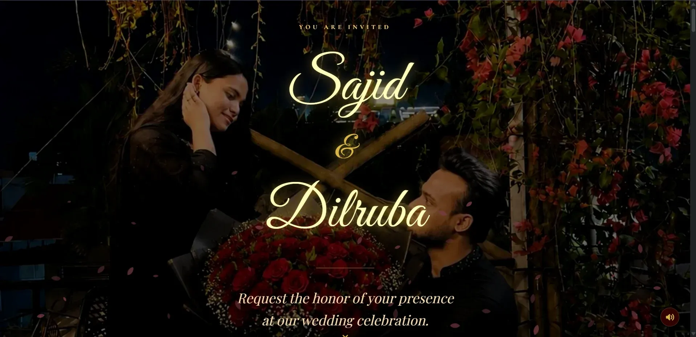
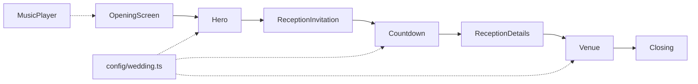

<div align="center">
  

  <p><code>Reception edition of the digital wedding invitation, focused on a single event.</code></p>

  <a href="https://sajid-dilruba-reception.vercel.app/"></a>
  
  <br>
  
  
  
  
  
</div>


## ◈ Overview

A trimmed variant of the main invitation built for the wedding reception. The page is short: hero, a written invitation, live countdown, reception details and a venue section with a maps link. The gallery, scratch card, love story, RSVP and guest wishes sections of the main version are not included.

It is a sibling of [my-wedding-invitation](https://github.com/Saji-d/my-wedding-invitation) and shares its stack and design language (burgundy, gold and ivory with Great Vibes and Playfair Display). Content comes from a single typed config file, `src/config/wedding.ts`.

<div align="center">
  
  <br><sub>Preview of the shared visual style, taken from the main invitation.</sub>
</div>


## ◈ Page Flow




## ◈ Tech Stack

| Layer | Technologies |
|---|---|
| Framework | Next.js 16 (App Router), React 19, TypeScript |
| Styling and motion | Tailwind CSS 4, Framer Motion |
| Utilities | date-fns, react-icons |
| Hosting | Vercel |


## ◈ Getting Started

```bash
npm install
npm run dev      # http://localhost:3000
npm run build
npm run lint
```

No environment variables are required. Edit `src/config/wedding.ts` to change the content.


## ◈ Author

**Sajidur Rahman Sajid**: Full-Stack Developer and AI engineer from Dhaka.

<p>
  <a href="https://www.sajidur.me"></a>
  <a href="https://www.linkedin.com/in/sajidur-rahman-sajid/"></a>
  <a href="https://github.com/Saji-d"></a>
  <a href="mailto:sajidsajidurrahman99@gmail.com"></a>
</p>

<sub>Built with love for a very special day.</sub>
